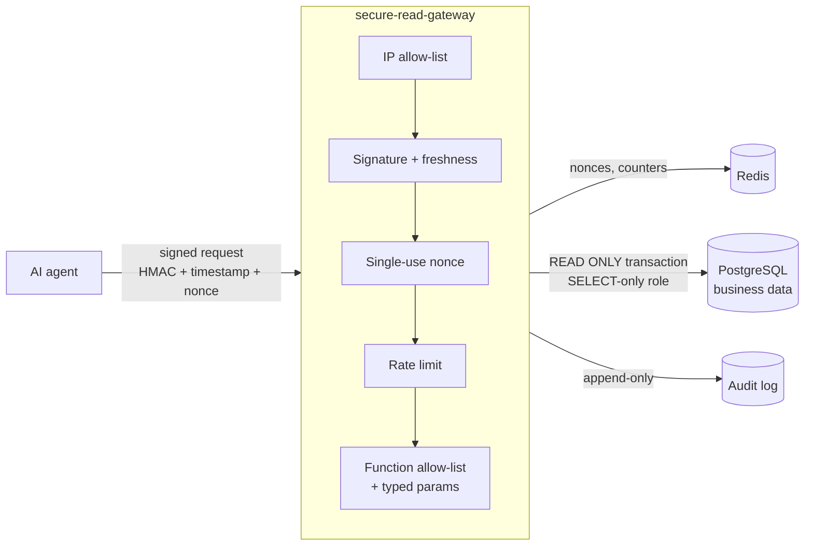

# secure-read-gateway

[](https://github.com/SaurabhTiwari95/secure-read-gateway/actions/workflows/ci.yml)
[](https://github.com/SaurabhTiwari95/secure-read-gateway/actions/workflows/codeql.yml)

A zero-trust, read-only API that lets AI agents query business data **without database
credentials and without changing the application that owns the data**.

Agents call named, allow-listed functions such as `list_overdue_invoices`, never raw SQL. Every
request is signed, single-use, rate-limited and audited. Every query runs read-only, as a database
user that can't write even if everything else failed.



The sample data is a made-up wholesaler, "Acme Traders": customers, products, invoices and payments.

## Contents

- [Features](#features)
- [Prerequisites](#prerequisites)
- [Install and run](#install-and-run)
- [Use it](#use-it)
- [Add a function](#add-a-function)
- [Configuration](#configuration)
- [Run the tests](#run-the-tests)
- [Troubleshooting](#troubleshooting)
- [Security model](#security-model)
- [How it scales](#how-it-scales)
- [Performance](#performance)
- [Design decisions](#design-decisions)
- [Project layout](#project-layout)

## Features

- **Signed requests:** HMAC-SHA256 over method, path, timestamp, nonce and body hash; constant-time compare.
- **No replays:** five-minute freshness window plus single-use nonces, shared through Redis across instances.
- **IP allow-list** (CIDR), optionally behind one trusted proxy.
- **Function allow-list stored as data:** add a capability with a reviewed `INSERT`, not a deploy.
- **SQL guard at load:** a function that could write, lock rows, sleep, read files or run dynamic SQL is refused and never runs.
- **Typed parameters:** int, decimal, date, bool and str, with bounds. Errors never echo what was sent.
- **Paging** with `has_more`, capped per function and globally.
- **Least privilege in the database:** `SELECT` on business tables only, `READ ONLY` transactions, statement timeout.
- **Append-only audit log**, enforced by a database trigger. Fail-closed: no audit record, no data.
- **Operations:** `/healthz` and `/readyz` endpoints, a non-root read-only container, docker compose, and a migration runner with sample data.

## Prerequisites

| Tool | Version | Needed for | Get it |
|---|---|---|---|
| Docker Desktop (or Docker Engine + Compose v2) | 24+ | Running the stack | <https://docs.docker.com/get-docker/> |
| Python | 3.12 | Examples, tests, `.env` generator | <https://www.python.org/downloads/> |
| Git | any recent | Cloning | <https://git-scm.com/downloads> |

## Install and run

### Windows (PowerShell)

```powershell
git clone https://github.com/SaurabhTiwari95/secure-read-gateway.git
cd secure-read-gateway
py -3.12 -m venv .venv
.\.venv\Scripts\Activate.ps1
pip install -r requirements-dev.txt
python scripts/make_env.py
docker compose up -d --build --wait api
```

### macOS / Linux

```bash
git clone https://github.com/SaurabhTiwari95/secure-read-gateway.git
cd secure-read-gateway
python3.12 -m venv .venv
source .venv/bin/activate
pip install -r requirements-dev.txt
python scripts/make_env.py
docker compose up -d --build --wait api
```

What happens:

1. `make_env.py` writes `.env` with fresh random secrets. It's git-ignored.
2. Compose starts PostgreSQL and Redis.
3. The `migrate` job creates the tables, the least-privilege role and the function allow-list, then
   loads sample data: 500 customers, 120 products, 6,000 invoices.
4. The API starts on `http://127.0.0.1:8000`, reachable from this computer only.

Check it:

```bash
curl http://127.0.0.1:8000/readyz
```

```json
{"status":"ready","database":true,"store":true}
```

Stop it with `docker compose down`, or `docker compose down -v` to delete the data as well.

## Use it

### Run the example agent

```bash
python examples/ask.py
```

You'll see something like this (the sample data is random, so your rows will differ):

```text
Functions I may call:
  - customer_balance: Amount invoiced, paid and outstanding for one customer.
  - list_customers: Customers, optionally filtered by city, oldest first.
  - list_overdue_invoices: Open invoices past their due date on a given day, oldest first.
  - sales_by_month: Invoice count and revenue per month for one year (void invoices excluded).
  - top_products: Products by revenue since a date.

Five oldest overdue invoices of 5,000 or more:
  #  412  Example Traders Pvt Ltd           18342.50  701 days
  ...

more pages: True   request id: 3f2c...
```

`purge_old_invoices` isn't listed. It's in the database on purpose, to show the guard refusing a
function that deletes data. The API logs `refused function purge_old_invoices: forbidden keyword: delete`.

### Call it from your own code

```python
from client import GatewayClient

with GatewayClient("http://127.0.0.1:8000", key_id="demo-agent", secret="<AGENT_SECRET from .env>") as gw:
    page1 = gw.call("list_customers", {"city": "Pune"}, page_size=50)
    page2 = gw.call("list_customers", {"city": "Pune"}, page=2, page_size=50)
    months = gw.call("sales_by_month", {"year": 2026})
```

An async client is included too (`AsyncGatewayClient`).

### The HTTP contract, for other languages

`POST /v1/call/{function}` with a JSON body `{"params": {...}, "page": 1, "page_size": 50}` and these headers:

| Header | Value |
|---|---|
| `X-Key-Id` | your key id |
| `X-Timestamp` | Unix seconds, within 5 minutes of the server clock |
| `X-Nonce` | 16–64 random URL-safe characters, never reused |
| `X-Signature` | hex HMAC-SHA256, using your secret, of `METHOD\nPATH\nTIMESTAMP\nNONCE\nsha256_hex(body)` |

Response:

```json
{"function": "list_customers", "page": 1, "page_size": 50, "has_more": true,
 "rows": [{"id": 1, "name": "...", "city": "Pune", "created_on": "2024-03-02"}],
 "request_id": "..."}
```

Money comes back as strings (`"18342.50"`) so no precision is lost.

### Errors

| Status | `error` | Meaning |
|---|---|---|
| 401 | `unauthorized` | Missing or wrong signature, or an unknown key |
| 401 | `stale_request` | Timestamp more than 5 minutes off. Check your clock |
| 401 | `replayed_request` | This nonce was already used |
| 403 | `forbidden` | Your IP isn't in `ALLOWED_NETWORKS` |
| 404 | `unknown_function` | Not on the allow-list, or refused by the guard |
| 413 | `body_too_large` | Body over `MAX_BODY_BYTES` |
| 422 | `invalid_request` / `invalid_params` | `details` says which field and why (never the value you sent) |
| 429 | `rate_limited` | Over `RATE_LIMIT_PER_MINUTE`; see `Retry-After` |
| 504 | `query_timeout` | The query ran past the statement timeout |
| 500 | `internal_error` | Logged server-side with the `request_id`; no internals in the response |

## Add a function

Functions are rows in `gateway.functions`. Use `$1..$n` placeholders in parameter order. Leave out
`LIMIT`/`OFFSET`: the gateway adds paging.

```sql
INSERT INTO gateway.functions (name, description, sql, params, max_rows) VALUES (
  'invoices_for_customer',
  'Invoices for one customer, newest first.',
  $q$SELECT id, issued_on, due_on, status, total
     FROM acme.invoices WHERE customer_id = $1 ORDER BY issued_on DESC, id$q$,
  '[{"name": "customer_id", "type": "int", "min": 1}]',
  100
);
```

Run it as the admin user (for example `docker compose exec db psql -U acme_admin -d acme`). The
gateway picks it up within `REGISTRY_TTL_SECONDS` (default 60), with no restart. In a real
deployment, add it as a new file in `migrations/` so it's reviewed like code.

Parameter fields: `name`, `type` (`int` `decimal` `date` `bool` `str`), `required` (default true),
`default`, `min`, `max`, `max_length` (str, default 100), `description`.

## Configuration

All settings are environment variables (or `.env`).

| Variable | Purpose | Default | Required |
|---|---|---|---|
| `DATABASE_URL` | PostgreSQL DSN for the least-privilege `gateway_app` role | — | Yes |
| `REDIS_URL` | Redis for nonces and rate limits. Empty = in-memory: **run one instance only** | empty | For more than one instance |
| `CLIENT_KEYS` | JSON `{"key-id": "secret"}`; secrets 32+ characters | `{}` | Yes |
| `ALLOWED_NETWORKS` | JSON list of CIDRs allowed to call | `["127.0.0.1/32"]` | No |
| `TRUST_PROXY_HEADERS` | Use the right-most `X-Forwarded-For` entry. Only behind one trusted proxy | `false` | No |
| `MAX_CLOCK_SKEW_SECONDS` | Freshness window for timestamps | `300` | No |
| `RATE_LIMIT_PER_MINUTE` | Requests per key per minute | `120` | No |
| `MAX_BODY_BYTES` | Largest request body | `16384` | No |
| `MAX_PAGE_SIZE` | Global cap on rows per page | `200` | No |
| `REGISTRY_TTL_SECONDS` | How often the function list is reloaded | `60` | No |
| `STATEMENT_TIMEOUT_MS` | Per-query timeout | `5000` | No |
| `DB_POOL_MIN` / `DB_POOL_MAX` | Connection pool size per process | `1` / `10` | No |
| `ENABLE_DOCS` | Serve `/docs` and `/openapi.json` | `false` | No |
| `LOG_LEVEL` | `DEBUG`, `INFO`, `WARNING`… | `INFO` | No |

The migrate job (`python -m app.migrate --seed`) also needs:

| Variable | Purpose |
|---|---|
| `ADMIN_DATABASE_URL` | DSN of the database owner (only the migrate job uses it) |
| `APP_DB_PASSWORD` | Password it sets on `gateway_app` (16+ characters) |

The compose file reads `POSTGRES_PASSWORD`, `APP_DB_PASSWORD` and `CLIENT_KEYS` from `.env`.
`scripts/make_env.py` creates all of them.

## Run the tests

Unit and API tests (no Docker needed):

```bash
pytest
```

```text
108 passed, 6 skipped ... TOTAL ... 94%
```

The 6 skipped tests are the integration tests. Run them against the real stack:

```bash
docker compose up -d --wait db redis
```

Set these (PowerShell: `$env:NAME = "value"`; macOS/Linux: `export NAME=value`), using the
passwords from your `.env`:

```text
INTEGRATION=1
ADMIN_DATABASE_URL=postgresql://acme_admin:<POSTGRES_PASSWORD>@127.0.0.1:5432/acme
APP_DB_PASSWORD=<APP_DB_PASSWORD>
DATABASE_URL=postgresql://gateway_app:<APP_DB_PASSWORD>@127.0.0.1:5432/acme
REDIS_URL=redis://127.0.0.1:6379/0
```

Then migrate and run everything:

```bash
python -m app.migrate --seed
pytest
```

Lint, the dependency audit and the pre-publish scan:

```bash
ruff check . && ruff format --check .
pip-audit -r requirements-dev.txt
python scripts/prepublish_check.py
```

CI runs all of this on every push, plus CodeQL, gitleaks, an image build that must run as
non-root, and a full `docker compose` smoke test with the example agent.

## Troubleshooting

| Problem | Fix |
|---|---|
| `docker compose up` says `set POSTGRES_PASSWORD in .env` | Run `python scripts/make_env.py` first |
| `/readyz` returns 503 with `"database": false` | Run `docker compose logs migrate`; the migrate job must finish before the API is ready |
| Example agent gets `403 forbidden` | Your request reaches the container from a Docker network address. Check `ALLOWED_NETWORKS` in `.env` includes it (the generated `.env` allows the private ranges) |
| `401 stale_request` | Your computer's clock is off by more than 5 minutes; sync it |
| `401 unauthorized` from your own client | Sign the exact bytes you send; the path must include the query string if there is one |
| Port 5432, 6379 or 8000 already in use | Stop the other service, or change the left-hand port in `docker-compose.yml` |
| `Activate.ps1 cannot be loaded` | Run `Set-ExecutionPolicy -Scope CurrentUser RemoteSigned` once |
| Changed `APP_DB_PASSWORD` and the API can't connect | Re-run the migrate job: `docker compose run --rm migrate` (it updates the role's password) |

## Security model

Three independent layers stop writes. Any one of them is enough on its own:

| Layer | What it does |
|---|---|
| SQL guard (`app/sqlguard.py`) | Refuses, at load time, any function that isn't a single `SELECT`/`WITH` or that mentions write keywords, row locks or dangerous functions |
| `READ ONLY` transaction (`app/db.py`) | PostgreSQL rejects any write inside it |
| Database grants (`migrations/003_grants.sql`) | `gateway_app` can `SELECT` business tables, read the allow-list and `INSERT` audit rows. Nothing else |

The integration tests prove the third layer directly: they connect as `gateway_app` and try to
write.

Request checks run in this order: IP allow-list → signature → freshness → nonce (claimed only after
the signature checks out, so strangers can't use up nonces) → rate limit. See [SECURITY.md](SECURITY.md).

## How it scales

- **Stateless API.** Nonces and rate-limit counters live in Redis, so you can run any number of
  instances behind a load balancer. Each process keeps a small, capped connection pool.
- **Reads can move to replicas.** Point `DATABASE_URL` at a read replica; the gateway never writes
  business data.
- **The function list is cached** in each process and reloaded every `REGISTRY_TTL_SECONDS`, with one
  reload at a time.
- **Indexes** exist for every filter the shipped functions use (status + due date, customer, issue
  date, line → invoice/product).

What breaks first, and the fix:

| Load | First bottleneck | Fix |
|---|---|---|
| 10× | Audit inserts (one per call) on the primary | Batch audit writes, or send them to a queue and write them asynchronously |
| 10× | Offset paging on deep pages | Keyset paging (`WHERE id > $last ORDER BY id`) for large lists |
| 100× | Repeated identical reads | Short-TTL result cache in Redis, keyed by function + params |
| 100× | One Redis | Redis cluster, or a managed service such as ElastiCache |

## Performance

Measured on a busy Windows laptop, **in-process** (the client and the gateway share one Python
thread, with no network and an in-memory stand-in for the database). This measures the gateway's
own overhead: signing, checks, validation and JSON.

```bash
python scripts/loadtest.py --in-process --requests 5000 --concurrency 50
```

| Run | Throughput | p50 | p95 | p99 |
|---|---|---|---|---|
| 1 | 404 req/s | 114 ms | 153 ms | 186 ms |
| 2 | 443 req/s | 112 ms | 139 ms | 144 ms |
| 3 | 433 req/s | 113 ms | 139 ms | 142 ms |

Latency here is mostly queueing: 50 concurrent callers share one thread.

**One optimisation came from measuring.** A profile showed FastAPI's generic JSON encoder costing
more than the request checks. Encoding rows with a small type-aware function and returning
`JSONResponse` directly raised throughput from about 230–470 to about 560–640 req/s on the same
machine. That before/after was measured on the earlier dependency versions. The table above is
on the current pinned versions, after a security upgrade.

End to end against the real stack (run it yourself after `docker compose up`):

```bash
python scripts/loadtest.py --requests 2000 --concurrency 20
```

## Design decisions

- **Functions, not SQL.** Agents get named capabilities with typed parameters; reviewers see
  exactly what each agent can read.
- **Three write barriers** rather than trusting one. Each is simple enough to test on its own.
- **HMAC with nonces** instead of static API keys, so a leaked log line or captured request can't
  be replayed.
- **Fail closed on audit.** If the audit row can't be written, the caller gets no data.
- **Data minimisation.** Customer emails exist in the sample data but no function returns them.
- **Plain SQL migrations** with a small runner (`app/migrate.py`) instead of an ORM: the gateway's
  value is in reviewable SQL.

The reasoning behind these is written up in my
[architecture notes](https://github.com/SaurabhTiwari95/architecture-notes): ADRs 0001–0002 and note 01.

## Project layout

```text
app/
  main.py        HTTP API, request checks, paging, audit
  signing.py     HMAC signing (shared with the client)
  sqlguard.py    static read-only check for registered SQL
  registry.py    function allow-list, typed params, TTL cache
  stores.py      nonce store and rate limiter (Redis / in-memory)
  db.py          pooled PostgreSQL access, READ ONLY transactions
  config.py      settings from environment variables
  migrate.py     migrations, app role, sample data
client/          Python client (sync and async)
examples/ask.py  example agent
migrations/      schema, grants, function allow-list
scripts/         make_env, loadtest, prepublish_check
tests/           unit, API and integration tests
```

## What's next

- Keyset paging option per function.
- Per-key function permissions (today every key sees the whole allow-list).
- OpenTelemetry traces, and metrics per function and key.
- The companion project, **governed-write-api**, for the narrow, approved write path.

---

AI-assisted (Claude Code); design and review by me.

Licence: [MIT](LICENSE). Security: [SECURITY.md](SECURITY.md).
